<picture>
  <source media="(prefers-color-scheme: dark)" srcset="assets/hero-dark.svg">
  <source media="(prefers-color-scheme: light)" srcset="assets/hero-light.svg">
  
</picture>

<a href="https://linkedin.com/in/abdul-aziz-muxitdinov"><picture>
  <source media="(prefers-color-scheme: dark)" srcset="assets/link-linkedin-dark.svg">
  <source media="(prefers-color-scheme: light)" srcset="assets/link-linkedin-light.svg">
  
</picture></a>
<a href="https://t.me/capybaraml"><picture>
  <source media="(prefers-color-scheme: dark)" srcset="assets/link-telegram-dark.svg">
  <source media="(prefers-color-scheme: light)" srcset="assets/link-telegram-light.svg">
  
</picture></a>

<picture>
  <source media="(prefers-color-scheme: dark)" srcset="https://raw.githubusercontent.com/mukhitdinov-abd/mukhitdinov-abd/output/pulse-dark.svg">
  <source media="(prefers-color-scheme: light)" srcset="https://raw.githubusercontent.com/mukhitdinov-abd/mukhitdinov-abd/output/pulse-light.svg">
  
</picture>
